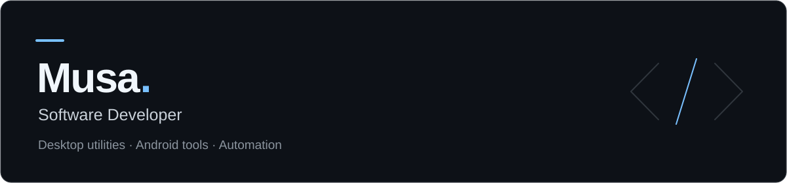

I build utilities.

[musa.wtf →](https://musa.wtf) · [Explore my repositories →](https://github.com/googIeuser?tab=repositories)

## Selected projects

| Project | What it does | Stack |
| :--- | :--- | :--- |
| [**NETWatcher**](https://github.com/googIeuser/NETWatcher) | Connection monitoring: latency, jitter and packet loss. | Flutter · Rust |
| [**WispSign**](https://github.com/googIeuser/WispSign) | Local iOS IPA re-signing and USB installation on Windows. | Python · Svelte |
| [**Claude-Pro-Dev**](https://github.com/googIeuser/Claude-Pro-Dev) | Claude Code plugin for Windows: multi-role coordination, effort levels and session tracking. | PowerShell · TypeScript |
| [**PromptCard**](https://github.com/googIeuser/promptcard) | Firefox extension that turns webpage images into detailed generation prompts. | JavaScript · WebExtension |
| [**USBWatcher**](https://github.com/googIeuser/USBWatcher) | Inspects USB devices, negotiated speeds, identifiers and port paths. | Flutter · Rust |
| [**FPSWatcher**](https://github.com/googIeuser/FPSWatcher) | Game telemetry and performance profiling. | Flutter · Rust |

## Closed-source projects

| Project | Stack | Link |
| :--- | :--- | :--- |
| **ZappDM** | C# | [Releases](https://github.com/googIeuser/ZappDM-releases/releases) |
| **Portfolio** | React · Vite | [musa.wtf](https://musa.wtf) |
| **SubAI** | TypeScript | — |

## Technologies

**Core stack**

**Also work with** · Java, C#, Swift, C, C++, JavaScript, Svelte, React, PowerShell, Shell, HTML, CSS and Node.js.

**Tools & data** · Git, Docker, Firebase, SQLite, PostgreSQL, Android Studio, Xcode, VS Code, Figma and Postman.

  
Contribution activity

   
  <picture>
    <source media="(prefers-color-scheme: dark)" srcset="https://raw.githubusercontent.com/googIeuser/googIeuser/output/github-snake-dark.svg" />
    <source media="(prefers-color-scheme: light)" srcset="https://raw.githubusercontent.com/googIeuser/googIeuser/output/github-snake.svg" />
    
  </picture>

